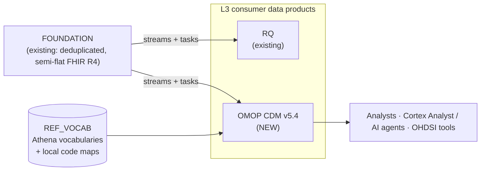

# FHIR → OMOP CDM transformation (L3 data product)

A design for a new **L3 consumer data product** in Snowflake that exposes our FHIR R4 foundation data as an **OMOP Common Data Model (CDM)**, so analytical questions (and AI agents) can be answered with simple, standard SQL instead of repeated FHIR JSON parsing and code-system juggling.

> **Status:** design / pitch. No implementation yet. FHIR stays our base; OMOP is an additional product on top, not a replacement.

## The problem in one paragraph

FHIR is built for exchange, not analytics. A question like *"patients aged 20–30 with an HbA1c above 9% in the last year"* needs us to join Patient and Observation through string references, unnest `code.coding[]` arrays, recognise the same lab under SNOMED, LOINC, CPT and submitter-specific **local codes**, and normalise values and units. Every consumer (analyst or AI agent) has to re-solve this. OMOP solves it once, centrally: one standard concept per meaning, one table per clinical domain, one `person_id` key.

## What we are proposing

Landing and foundation are unchanged and out of scope for this repo; they are context only. This repo covers what is **new**: the vocabulary layer, the OMOP staging/mapping logic and the OMOP CDM tables in L3.

## Why it is worth doing

| Benefit | What it means for us |
|---|---|
| **One model for every analytical question** | Person, visits, conditions, measurements and drugs in predictable tables with predictable columns |
| **Code-system normalisation** | SNOMED, ICD-10, LOINC, CPT and mapped local codes resolve to one standard concept |
| **Hierarchies for free** | "Any statin" or "any diabetes" is a single join on `CONCEPT_ANCESTOR` |
| **AI-friendly** | A stable, documented schema is a much better text-to-SQL target than nested JSON |
| **Ecosystem** | Data-quality checks (DQD), characterisation (Achilles), cohort tooling, published phenotypes |
| **FHIR untouched** | Full-fidelity FHIR remains in foundation; every OMOP row carries lineage back to it |

## Honest limits

- **Local codes do not map themselves.** Athena cannot know what a submitter's `LAB123` means. Coverage depends on a mapping effort per submitter. We report coverage rather than hide it (unmapped rows get concept `0`, original code preserved).
- **Lossy by design.** Not every FHIR field has an OMOP home. See the [mapping matrix](docs/design/mapping-matrix.md).
- **Vocabulary is a product.** Loading, versioning and licensing (notably **CPT4**) must be owned.
- **Derived tables** (`OBSERVATION_PERIOD`, eras) need person-level recomputation, not row-level mapping.

## Documents

| Document | Purpose |
|---|---|
| [`docs/design/omop-l3-design.html`](docs/design/omop-l3-design.html) | **Start here, and present from this.** One self-contained page (open in a browser, works offline, light/dark, printable) covering summary, problem, OMOP concepts, patient example, FHIR vs OMOP queries, architecture diagrams, a filterable mapping matrix, advantages, risks, benchmark, plan, decisions and glossary. |
| [`docs/design/architecture.md`](docs/design/architecture.md) | Architecture as Mermaid diagrams (renders on GitHub) |
| [`docs/design/mapping-matrix.md`](docs/design/mapping-matrix.md) | Mapping matrix in plain text, for review and diffs |
| [`docs/design/benchmark-questions.md`](docs/design/benchmark-questions.md) | Benchmark questions and scoring template |
| [`docs/design/open-questions.md`](docs/design/open-questions.md) | Decisions, open questions, prerequisites and phased plan in plain text |

The Markdown files mirror content that is also in the HTML page; if they diverge, treat the HTML as the current version.

## Sources

- OMOP CDM documentation: <https://ohdsi.github.io/CommonDataModel/>
- OHDSI, the Common Data Model: <https://www.ohdsi.org/data-standardization/the-common-data-model/>
- HL7 FHIR-to-OMOP Implementation Guide (STU1 ballot, CDM 5.4 target): <https://build.fhir.org/ig/HL7/fhir-omop-ig/en/>

Concept IDs shown in the documents are illustrative and must be verified against the Athena vocabulary release we adopt.
