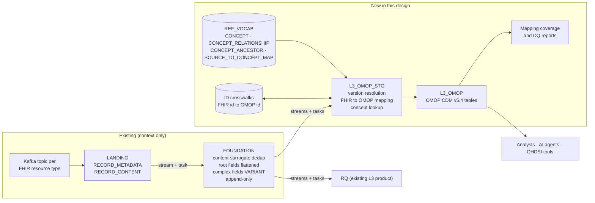
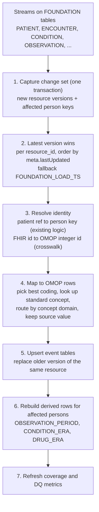
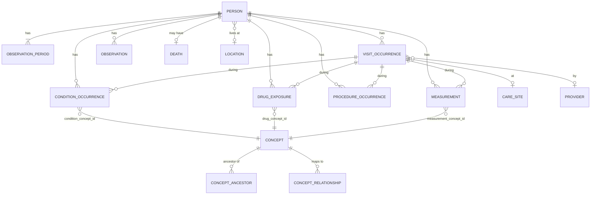
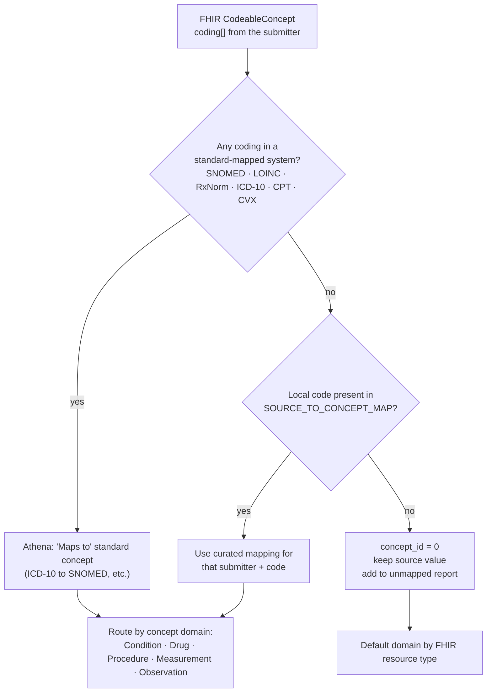

# Architecture

Landing and foundation are shown only as context. The new work is everything to the right of FOUNDATION.

## 1. Where the OMOP product sits

## 2. Refresh flow (streams and tasks)

Event tables map row by row. Derived tables are rebuilt for the persons that changed.

Design notes:

- **Append-only foundation, versioned resources.** If an Observation moves from `preliminary` to `final`, foundation holds two rows (different content, different surrogate). Step 2 keeps only the latest per `resource_id`; step 5 replaces the earlier OMOP row so there is never a duplicate fact.
- **Stream mechanics.** A stream's offset advances when its change set is consumed in a committed transaction. Step 1 copies the changes from every foundation stream into a change-log table in a single transaction, and later steps read that table. This keeps the multi-stream product consistent and replayable.
- **Late-arriving data.** A Condition may arrive before its Encounter. `visit_occurrence_id` is nullable; the person-level rebuild back-fills the link when the Encounter arrives.
- **Identity.** Person identity uses the existing resolution logic. L3 consumes its output as a crosswalk of FHIR Patient id to person key, which becomes `PERSON.person_id`.

## 3. Person-centric model (first-slice tables highlighted in the matrix)

## 4. Proposed schemas

| Schema | Contents | Notes |
|---|---|---|
| `REF_VOCAB` | Athena tables plus `SOURCE_TO_CONCEPT_MAP` for local codes | Shared reference; versioned by vocabulary release. Other L3 products can use it. |
| `L3_OMOP_STG` | Change log, version resolution, ID crosswalks, mapping views | Internal, not for consumers |
| `L3_OMOP` | OMOP CDM v5.4 tables, `CDM_SOURCE` | Consumer-facing |
| `L3_OMOP_QA` | Mapping coverage, unmapped-code report, DQ results | Drives the mapping backlog and the pitch metrics |

Every OMOP row keeps `*_source_value`, `*_source_concept_id` and a lineage column pointing to the foundation `RESOURCE_ID`, so any fact can be traced back to full-fidelity FHIR.

## 5. Concept mapping logic (per coded field)

If several codings map, a documented priority order decides (for example the most specific standard system first, then fall back through the list).
